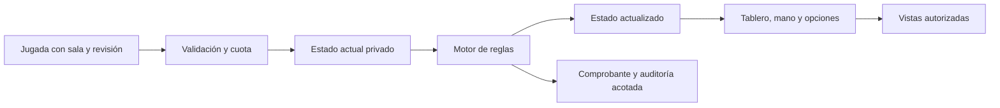

# Escalabilidad

Cómo guarda el servidor cada duelo, qué límites aplica y cómo medir el rendimiento en local.

## Estado del duelo

El estado actual de cada duelo se guarda en `current_duel` (reglas versión 1, formato de estado versión 2). Los efectos pendientes (reciclaje, dados, Re-lanza, activaciones) son datos tipados; las referencias compartidas entre activaciones se restauran con una tabla de nodos. Ninguna continuación depende de funciones guardadas en memoria.

Una jugada carga el estado, valida y ejecuta un comando y guarda el estado resultante. No reconstruye la partida a partir del historial. El registro de texto interno no se guarda, para que el estado no crezca con el número de jugadas.

En la misma transacción se preparan tres paquetes autorizados: el tablero compartido, la mano y las revelaciones privadas, y las opciones propias. Las vistas `my_board`, `my_duel_hand` y `my_choices` solo buscan esas filas por identidad y sala. Los paquetes privados y las opciones se reescriben solo cuando cambia su contenido. El tablero publica la revisión esperada de cada paquete, y el cliente espera una combinación coherente antes de presentarla. Las cantidades de cartas viajan en el tablero; las manos ocultas no se repiten en los paquetes privados.

El cliente deja de suscribirse a los datos de preparación al entrar en combate. `my_duel` combina los paquetes almacenados sin ejecutar el motor.



## Auditoría, comprobantes y versiones

- La auditoría privada conserva las últimas **128** jugadas por sala, con el azar de cada una. Sirve para diagnóstico reciente, no para repetir partidas largas completas.
- Los comprobantes de comandos aceptados (`DuelReceipt`) están separados de la auditoría y duran lo que la sala. Compactar la auditoría no permite volver a ejecutar un comando antiguo.
- Una versión de reglas o de formato desconocida se rechaza; nunca se sustituye en silencio por reglas nuevas.
- Las jugadas se envían con `play_duel_v_2` y su resultado privado (`my_move_result`). Un rechazo se confirma en la transacción para conservar la cuota consumida.

## Límites y vencimientos

| Política | Valor |
|---|---:|
| Solicitudes de jugada por participante de sala | 120 por ventana de 10 segundos |
| Salas nuevas por base | 200 por minuto |
| Salas retenidas a la vez, incluidos resultados | 500 |
| Búsquedas casuales en espera | 500, una por identidad |
| Renovación / vigencia de una búsqueda casual | 5 / 15 segundos |
| Sala en espera o preparación sin actividad | 10 minutos |
| Duelo preparado o en curso sin jugadas ni reconexión | 2 horas |
| Resultado sin cerrar | 24 horas |

- Los reintentos idénticos de un comando aceptado se resuelven con su comprobante. Los intentos bien formados pero rechazados consumen cuota y guardan un resultado privado. Los mensajes mal formados se rechazan antes de leer el estado.
- Cada sala recibe su temporizador al crearse (`room_expiry`); las jugadas y reconexiones lo renuevan con un identificador nuevo, para que un aviso antiguo no elimine una sala renovada. Solo el planificador de la base puede ejecutar la expiración.
- La cola casual es una tabla privada con vencimiento programado. Buscar empareja la entrada viva más antigua y crea ambos miembros y repartos en una sola transacción. Los límites de creación de salas también se aplican a los duelos casuales.

Son límites operativos del módulo, no una capacidad garantizada, y no sustituyen límites de conexiones y tráfico en la infraestructura.

## Medir y comprobar

Con `tests/server/dev` publicado en un servidor local en el puerto 3100:

```bash
dotnet run --project tests/pvp/Relick.Pvp.Tests.csproj -- --rate-test http://127.0.0.1:3100 relick-dev
dotnet run --project tests/pvp/Relick.Pvp.Tests.csproj -- --load http://127.0.0.1:3100 relick-dev artifacts/scalability-load.json
```

- `--load` lanza oleadas de partidas con dos clientes por sala y guarda jugadas por segundo y latencias en el archivo indicado. Las cifras de una máquina local sirven para detectar regresiones, no para estimar la capacidad de un servidor remoto.

La prueba de temporizadores usa el módulo `tests/server/lifecycle`, con vencimientos de dos segundos. **No lo publiques en un servidor compartido.**

```bash
spacetime publish relick-expiry-check --server http://127.0.0.1:3100 --module-path tests/server/lifecycle --no-config
dotnet run --project tests/pvp/Relick.Pvp.Tests.csproj -- --expiry-test http://127.0.0.1:3100 relick-expiry-check
```

Persistencia tras reiniciar el servidor: `--restart-prepare` deja una decisión pendiente y escribe un archivo privado; reinicia el servidor con el mismo directorio de datos y ejecuta `--restart-verify`, que continúa el efecto y limpia el archivo y la sala.

```bash
dotnet run --project tests/pvp/Relick.Pvp.Tests.csproj -- --restart-prepare http://127.0.0.1:3100 relick-dev /tmp/relick-restart-check.json
# Reinicia el servidor local con el mismo directorio de datos.
dotnet run --project tests/pvp/Relick.Pvp.Tests.csproj -- --restart-verify http://127.0.0.1:3100 relick-dev /tmp/relick-restart-check.json
```

Las pruebas del motor recorren duelos completos y comparan cada estado y sus opciones después de guardar y restaurar, incluidas decisiones de reciclaje y efectos anidados.
