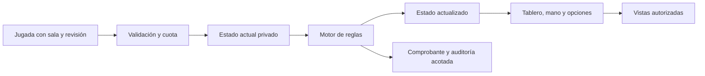

# Escalabilidad · primera base de medición

Fecha de trabajo: 6 de noviembre de 2026, America/Mexico_City. CLI, Runtime y SDK 2.14.1; servidor C# WASI/.NET 8.

## Cambios implementados

El estado actual de cada duelo se guarda en `current_duel`, con reglas versión 1 y formato de estado versión 1. Los efectos de reciclaje, dados, Re-lanza y activaciones pendientes son datos tipados; las referencias compartidas entre activaciones se restauran con una tabla de nodos. Ninguna continuación de reglas depende de funciones guardadas en memoria.

Una jugada carga un estado, valida y ejecuta un comando, y guarda el estado resultante. No consulta el historial para reconstruir partidas actuales. El registro de texto interno no se incluye en el estado persistido, para evitar crecimiento por número de jugadas.

En la misma transacción se preparan tres partes autorizadas: tablero compartido, mano/revelaciones privadas y opciones propias. Las vistas `my_board`, `my_duel_hand` y `my_choices` solo hacen búsquedas por identidad/sala en esas filas. Las partes privadas y opciones se actualizan solo cuando cambia su contenido. El tablero publica las revisiones esperadas de cada parte, y el cliente espera una combinación coherente antes de presentarla. Las cantidades de cartas viajan en el tablero; las manos ocultas no se repiten como listas de reversos en los paquetes privados.

El cliente deja de suscribirse a los datos de preparación cuando entra en combate. `my_duel` queda como vista de compatibilidad que combina los paquetes almacenados; tampoco ejecuta el motor.



## Historial, comprobantes y versiones

- La auditoría privada conserva las últimas **128** jugadas por sala.
- Los comprobantes de comandos aceptados están separados de la auditoría y se conservan hasta cerrar o expirar la sala. Compactar la auditoría no permite ejecutar otra vez un comando antiguo.
- Una versión de reglas o formato no reconocida se rechaza; no se sustituye silenciosamente por reglas nuevas. Los cambios futuros de balance requieren versionar reglas y definir migración o convivencia de versiones.
- El protocolo de comandos es **2**, mediante `play_duel_v_2` y su resultado privado. Una transacción puede confirmar un rechazo para conservar la cuota consumida. Se retiró el reducer obsoleto `play_duel`; el cliente utiliza únicamente la función actual.

La auditoría acotada sirve para diagnóstico reciente. Una repetición completa de partidas largas requeriría archivado adicional; no se promete conservar todo el historial después de compactarlo.

## Límites y vencimientos de desarrollo

| Política | Valor actual |
|---|---:|
| Solicitudes de jugada nuevas, por participante de sala | 120 por ventana de 10 segundos |
| Nuevas salas admitidas, por base | 200 por minuto |
| Salas retenidas simultáneamente, incluidos resultados | 500 |
| Búsquedas casuales en espera | Hasta 500, una por identidad |
| Renovación / vigencia de búsqueda casual | 5 / 15 segundos |
| Sala en espera o preparación sin actividad | 10 minutos |
| Duelo preparado/en curso sin jugadas ni reconexión | 2 horas |
| Resultado sin cerrar ni volver a conectar | 24 horas |

Los reintentos idénticos de comandos ya aceptados se resuelven con su comprobante. Los intentos de jugada bien formados pero rechazados consumen cuota y guardan un resultado privado; no lanzan una excepción que deshaga ese consumo. Los mensajes mal formados se rechazan antes de leer el estado del motor. La cuota por participante se elimina al retirar su sala; la admisión global limita la creación de salas sucesivas.

Cada sala recibe su temporizador al crearse; las jugadas y reconexiones renuevan el vencimiento. Cada renovación crea un identificador de temporizador nuevo para que un aviso antiguo no elimine una sala renovada. Solo el planificador de la base puede ejecutar la expiración. Se retiró el mantenimiento que buscaba salas antiguas sin temporizador y sus dos tablas auxiliares; la caducidad normal continúa en `room_expiry`.

Son límites operativos iniciales, no una capacidad garantizada. La protección del módulo no sustituye límites de conexiones/tráfico en infraestructura ni cuentas de usuario estables.

La cola casual es una tabla privada con vencimiento programado. Buscar empareja
la entrada viva más antigua y crea ambos miembros/repartos en una sola transacción;
no recorre salas privadas para elegir rival. La consulta está acotada por el límite
de cola. Las renovaciones reemplazan el identificador de temporizador para que
una expiración antigua no elimine una búsqueda renovada. Los controles de admisión
de salas también se aplican a los duelos casuales.

Las mediciones siguientes preceden a las señales visuales añadidas al tablero compartido de [interfaz](UI.md). Esas señales agregan datos al JSON por revisión; las cifras de volumen no deben interpretarse como una medición del protocolo visual posterior.

## Medición local de concurrencia

Oleadas de partidas nuevas, con hasta 50 jugadas por partida, dos clientes por sala y cierre al terminar. Servidor y generadores en la misma computadora, 16 procesadores lógicos visibles y .NET 8.0.33. SpacetimeDB 2.14.1, sin la optimización opcional `wasm-opt`. La latencia corresponde a confirmación observada por el remitente; el controlador también espera la actualización de ambos jugadores antes de enviar la siguiente jugada.

| Partidas | Clientes | Jugadas | Jugadas confirmadas/s | Latencia p95 |
|---|---|---|---|---|
| 1 | 2 | 50 | 39.9 | 52.6 ms |
| 10 | 20 | 500 | 168.0 | 73.3 ms |
| 25 | 50 | 1250 | 188.6 | 153.3 ms |
| 50 | 100 | 2500 | 202.6 | 259.3 ms |

La prueba completó todas las oleadas. El volumen de JSON de las actualizaciones separadas quedó prácticamente igual al equivalente de enviar el estado completo con el modelo actual, aproximadamente entre 0 % y 2 % menos en estas muestras. El beneficio principal comprobado es eliminar reconstrucciones y desacoplar las partes; no se atribuye una reducción grande de ancho de banda. Este conteo no incluye framing, compresión ni otros costes del transporte.

Estos resultados **no determinan la capacidad máxima** y **no miden Maincloud**. Son una referencia local para detectar regresiones. Se deben repetir en el entorno y región elegidos, con sesiones prolongadas y escenarios de reconexión/expiración masiva, antes de fijar objetivos de usuarios o presupuesto.

## Medición local de recuperación de estado

Comparación en .NET nativo del camino anterior —deserializar apertura y entradas JSON y reproducirlas— con deserializar el estado actual. 20 calentamientos y 300 repeticiones por muestra. No incluye búsquedas de tablas ni ejecución WASI.

| Jugadas previas | Historial JSON y reproducción | Estado guardado | Bytes del estado |
|---|---|---|---|
| 10 | 0.131 ms | 0.125 ms | 2827 |
| 40 | 0.309 ms | 0.116 ms | 2814 |
| 90 | 0.748 ms | 0.059 ms | 2477 |

Los resultados completos están en `artifacts/scalability-load.json` y `artifacts/scalability-state.json`. El segundo archivo también informa la reproducción con entradas ya deserializadas, que no representa el camino anterior del servidor.

## Reproducir las comprobaciones

Con el módulo principal publicado en un servidor local en el puerto 3100:

```bash
dotnet run --project tests/Relick.Core.Tests.csproj
dotnet run --project tests/pvp/Relick.Pvp.Tests.csproj -- http://127.0.0.1:3100 relick-dev
dotnet run --project tests/pvp/Relick.Pvp.Tests.csproj -- --rate-test http://127.0.0.1:3100 relick-dev
dotnet run --project tests/pvp/Relick.Pvp.Tests.csproj -- --load http://127.0.0.1:3100 relick-dev artifacts/scalability-load.json
dotnet run --project tests/pvp/Relick.Pvp.Tests.csproj -- --state-benchmark
```

La prueba de temporizadores usa un **módulo local aislado**, no el módulo publicado en Maincloud:

```bash
spacetime publish relick-expiry-check --server http://127.0.0.1:3100 --module-path tests/server/lifecycle --no-config
dotnet run --project tests/pvp/Relick.Pvp.Tests.csproj -- --expiry-test http://127.0.0.1:3100 relick-expiry-check
```

El módulo de temporizadores usa vencimientos de dos segundos. **No se debe publicar en la base de desarrollo compartida ni en producción.** El módulo real está exclusivamente en `server/spacetimedb`.

Para probar persistencia tras reinicio, `--restart-prepare` escribe un archivo nuevo con permisos privados y deja una decisión pendiente. Reinicia el servidor con el mismo directorio de datos y ejecuta `--restart-verify`; la verificación continúa el efecto y elimina su archivo y sala de prueba:

```bash
dotnet run --project tests/pvp/Relick.Pvp.Tests.csproj -- --restart-prepare http://127.0.0.1:3100 relick-dev /tmp/relick-restart-check.json
# Reiniciar el servidor local usando el mismo --data-dir.
dotnet run --project tests/pvp/Relick.Pvp.Tests.csproj -- --restart-verify http://127.0.0.1:3100 relick-dev /tmp/relick-restart-check.json
```

Las pruebas de regresión incluyen 24 duelos de referencia y tres casos adicionales de efectos anidados, registrados antes de cambiar el motor. Los registros antiguos se comparan hasta su primer agotamiento: su reciclaje aleatorio fue sustituido por selección manual. Los duelos completos con las reglas actuales comparan cada estado y sus opciones después de guardar/restaurar y de reproducir su historial; incluyen decisiones de reciclaje y efectos anidados.

## Validación final

Pasaron 116 comprobaciones del motor y persistencia, 57 comprobaciones de red tanto locales como en Maincloud, las pruebas aisladas de migración/compactación y vencimiento, y la recuperación de una decisión pendiente tras reiniciar el servidor local. También se completó un duelo mediante los botones de Godot con el cliente actualizado. La prueba de concurrencia completó 4300 jugadas en sus cuatro oleadas.
